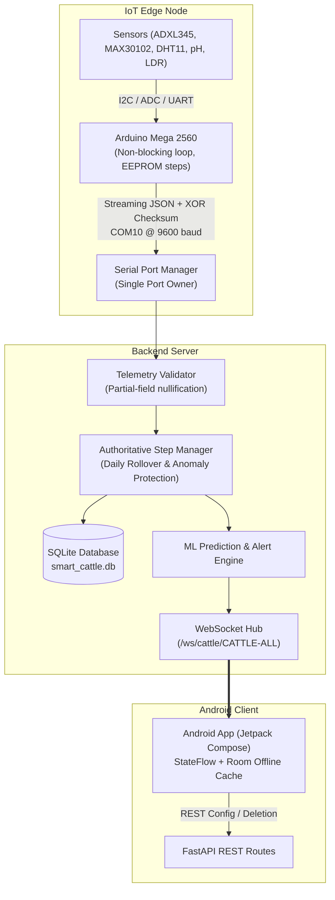

# 🐄 Smart Cattle Health Monitoring System


> **Status:** Active Development | **Version:** 2.0.0 (Jetpack Compose + FastAPI Architecture)

## 📌 Problem Statement
Traditional cattle monitoring relies on manual observation, which is labor-intensive and often detects diseases too late. This project provides a real-time, non-invasive, IoT-based wearable monitoring system that tracks the vital signs of cattle, detects anomalies using Machine Learning, and immediately alerts farmers through a modern Android application.

## ✨ Features
- **Real-time IoT Telemetry:** Live streaming of SpO2, BPM, temperature, pH, LDR, 3-axis accelerometer data, and step counting over 9600 baud serial.
- **Authoritative Step Counting:** Wear-leveled persistent lifetime steps on Arduino EEPROM paired with backend-authoritative daily rollover at midnight in the configured timezone (`TIMEZONE=Asia/Kolkata`).
- **Counter Anomaly Protection:** Reboots, reconnects, power-loss baseline resets, and duplicate packets are reconciled without data loss or negative totals.
- **Independent Partial Field Validation:** Malformed or uncontacted sensors output `null` without invalidating remaining valid sensors or fabricating fake values.
- **Checksum Integrity:** 8-bit streaming XOR checksum on serial lines to eliminate UART transmission corruptions.
- **Machine Learning Inference:** Deployed Scikit-Learn Random Forest pipeline predicts health risks instantly.
- **Baseline & Analytics Engine:** Individual historical baselines for each cow across multiple time windows (1h, 6h, 24h, 7d) for personalized deviation tracking.
- **Health Risk Assessment:** Dedicated service combining sensor validity, ML output, and baseline deviations to generate explainable risk scores (NORMAL, WATCH, WARNING, CRITICAL).
- **Alert Management:** Robust alert deduplication, cooldowns, and severity tracking (INFO, WARNING, CRITICAL).
- **Jetpack Compose Android Client:** Material 3 app with WebSocket live streaming, offline caching, configurable IP settings, and WCAG AA contrast.
- **Bi-directional Communication:** Backend pushes updates to Android while simultaneously sending hardware trigger alerts back to the Arduino (for local LCD/SMS feedback).

## 🏗️ System Architecture



## 🔌 Sensor Wiring Guide & Communication Architecture

| Sensor / Module | Arduino Mega Pin | Function |
|---|---|---|
| **MAX30105 / MAX30102** | I2C (SDA 20, SCL 21) | SpO2 & Heart Rate |
| **ADXL345** | I2C (SDA 20, SCL 21) | 3-axis acceleration & Step Detection |
| **DHT11** | D42 | Temperature & Humidity |
| **pH Sensor** | Serial3 (RX 15, TX 14) | pH level of water/feed |
| **LDR Sensor** | A2 | Ambient light intensity |
| **GPS NEO-6M** | **Serial1** (RX 19, TX 18) | Geolocation telemetry |
| **GSM SIM900A** | **Serial2** (RX 17, TX 16) | SMS emergency alerts |
| **LCD 16x2** | D30, 32, 34, 36, 38, 40 | Local hardware status display |

> **⚠️ Veterinary Limitations Disclaimer:**
> - MAX30102 pulse oximetry requires direct skin/vein contact. On cattle with thick hide and dark hair, readings require suitable sensor placement (e.g. inner ear, tail base) and will output `null` / `"Not Available"` when hide contact is lost.
> - Step detection thresholds and health risk alert rules are configurable defaults. Step accuracy during real cow walking and clinical alert limits are marked **UNVERIFIED** until evaluated in field trials with a certified veterinarian.

---

## 🛠️ Setup & Execution Guide

### 1. Arduino Mega Firmware
1. Open `arduino/arduino.ino` in Arduino IDE or compile via `arduino-cli`:
   ```bash
   arduino-cli compile --fqbn arduino:avr:mega arduino
   arduino-cli upload -p COM10 --fqbn arduino:avr:mega arduino
   ```
2. **Important COM Port Rule:** Close the Arduino Serial Monitor before starting the FastAPI backend. Only one application can own the serial port at a time.

### 2. FastAPI Backend
1. Python 3.9+ is required.
2. Setup environment and install dependencies:
   ```bash
   python -m venv venv
   .\venv\Scripts\activate
   pip install -r requirements.txt
   ```
3. Configure `.env`:
   ```ini
   SERIAL_PORT=COM10
   SERIAL_BAUDRATE=9600
   HARDWARE_MODE=real
   ALLOW_SIMULATION=false
   TIMEZONE=Asia/Kolkata
   ```
4. Start backend:
   ```bash
   START_BACKEND.bat
   ```
   Or via command line:
   ```bash
   python -m uvicorn app.main:app --host 0.0.0.0 --port 8000
   ```

### 3. Automatic SMS Alert System (Fast2SMS / Twilio / MSG91)

The system automatically sends an SMS notification whenever an incoming sensor reading or health status becomes **ABNORMAL**.

#### Workflow
$$\text{Arduino Sensors} \longrightarrow \text{FastAPI Serial Ingest} \longrightarrow \text{Physiological Evaluation} \longrightarrow \text{Deduplication Check} \longrightarrow \text{Instant SMS Alert}$$

#### Configuration
Open `backend/app/config.py` or `.env` and set:
```ini
# Target recipient mobile number (International E.164 or 10-digit Indian number)
ALERT_PHONE_NUMBER=+919876543210
SMS_ALERT_ENABLED=true
SMS_PROVIDER=fast2sms
```

#### Supported SMS Gateways
1. **Fast2SMS (Recommended for India — Free & Instant):**
   - Register at [fast2sms.com](https://www.fast2sms.com) and copy your Dev API Key.
   - In `.env`:
     ```ini
     SMS_PROVIDER=fast2sms
     FAST2SMS_API_KEY=your_fast2sms_api_key_here
     ```
2. **Twilio (International):**
   - Register at [twilio.com](https://www.twilio.com).
   - In `.env`:
     ```ini
     SMS_PROVIDER=twilio
     TWILIO_ACCOUNT_SID=your_account_sid
     TWILIO_AUTH_TOKEN=your_auth_token
     TWILIO_FROM_NUMBER=+1XXXXXXXXXX
     ```
3. **Mock Provider (Offline / Testing):**
   - In `.env`: `SMS_PROVIDER=mock`.
   - Records sent messages in memory and logs them to console without consuming provider credits.

#### SMS Message Format
```text
SMART CATTLE ALERT!

Cow ID: CATTLE-001

Condition: ABNORMAL

Sensor: Temperature

Current Reading: 40.8°C

Severity: HIGH

Time: 2026-11-13 21:05:00 IST

Please check the animal immediately.
```

#### Deduplication & Anti-Spam Guard
- **Single Alert on Onset:** Sends an SMS when a vital first exceeds physiological safety limits.
- **Continuous Suppression:** While the animal remains abnormal at 40.8°C, repeat SMS alerts are suppressed to prevent spamming your phone.
- **Recovery & Re-trigger:** Once the parameter returns to normal range and subsequently spikes again, a new SMS alert is dispatched.
- **Separate Alerts:** If multiple parameters are abnormal (e.g. Temperature and Heart Rate), separate alerts with distinct event IDs are delivered.
- **No Fake Data:** Simulated or null readings are strictly ignored and will never trigger SMS alerts.

### 4. Finding Computer LAN IP & Android Setup
1. On the PC running FastAPI, run `ipconfig` in Command Prompt or PowerShell and look for **IPv4 Address** (e.g., `192.168.1.5`).
2. In the Android App, click the **Settings icon** on the top bar.
3. Enter your PC's LAN IP (e.g., `192.168.1.5`). The app connects immediately to `ws://192.168.1.5:8000/ws/cattle/CATTLE-ALL`.

---

## 🧪 Testing & Verification

Run the full cross-layer automated test suites using `RUN_TESTS.bat`:
```bash
RUN_TESTS.bat
```
Or run individually:
- **Backend Tests (54 tests):**
  ```bash
  cd backend
  .\venv\Scripts\pytest.exe -v
  ```
- **Android Unit Tests:**
  ```bash
  cd android\SmartCattle
  .\gradlew.bat test
  ```

---

## 📄 Documentation Links
- [Telemetry Schema & Step Counting Specification](docs/TELEMETRY_SCHEMA.md)
- [System Architecture](docs/ARCHITECTURE.md)
- [Hardware Test Report](docs/HARDWARE_TEST_REPORT.md)
- [Configuration Guide](docs/CONFIGURATION.md)

## 📜 License
Distributed under the MIT License.
