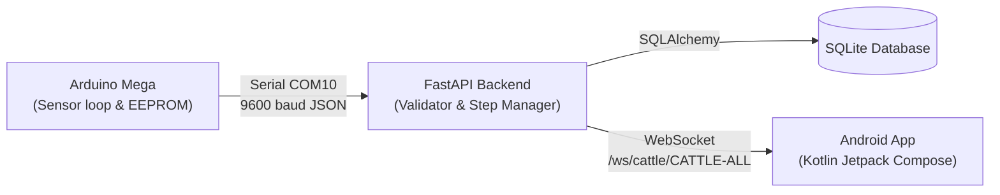

# Smart Cattle Telemetry Schema & Step Counting Specification

## 1. Overview & Architecture
This document specifies the authoritative telemetry contract between the Arduino Mega 2560 firmware, FastAPI backend, SQLite database, and Android Jetpack Compose application.

### Telemetry Pipeline


---

## 2. Telemetry Packet Specification (Arduino -> Backend)

### Wire Format
Packets are single-line, UTF-8 encoded JSON strings terminated by `\n`.
The packet includes an XOR-8 checksum (`chk`) calculated over all bytes preceding `,"chk":`.

```json
{
  "protocol_version": 1,
  "cattle_id": "CATTLE-001",
  "device_id": "SC-001",
  "boot_count": 7,
  "sequence": 142,
  "timestamp": 157640,
  "steps_today": 0,
  "step_count_lifetime": 125,
  "heart_rate": 78,
  "spo2": 98,
  "temperature": 38.6,
  "ph": 6.8,
  "ldr": 912,
  "ax": 0.05,
  "ay": 0.12,
  "az": 0.98,
  "mems_valid": 1,
  "hr_valid": 1,
  "spo2_valid": 1,
  "temp_valid": 1,
  "ph_valid": 1,
  "ldr_valid": 1,
  "chk": 42
}
```

### Field Definitions & Ranges

| Field Name | Type | Units | Valid Physical Range | Nullable | Description / Invalid Handling |
| :--- | :--- | :--- | :--- | :--- | :--- |
| `protocol_version` | integer | - | `1` | No | Protocol version identifier. |
| `cattle_id` | string | - | Non-empty string | No | Unique cattle ID (e.g., `CATTLE-001`). |
| `device_id` | string | - | Non-empty string | No | Physical device/collar ID (e.g., `SC-001`). |
| `boot_count` | integer | count | `>= 0` | Yes | Wear-leveled persistent boot counter from EEPROM. |
| `sequence` | integer | count | `0 - 65535` | No | Incremental packet sequence number. |
| `timestamp` | integer | ms | `>= 0` | No | Millis uptime from Arduino loop. |
| `step_count_lifetime`| integer | count | `>= 0` | No | Persistent lifetime steps from wear-leveled EEPROM. |
| `heart_rate` / `bpm` | integer | bpm | `20 - 300` | Yes | Heart rate from MAX30102. `null` if no finger/hide contact. |
| `spo2` | integer | % | `30 - 100` | Yes | Blood oxygen saturation. `null` if no hide contact. |
| `temperature` | float | °C | `-20.0 - 80.0` | Yes | Ambient/body temperature from DHT11. `null` if disconnect. |
| `ph` | float | pH | `0.0 - 14.0` | Yes | Water/feed pH level. `null` if disconnected. |
| `ldr` | integer | ADC (0-1023) | `0 - 1024` | Yes | Ambient light intensity. `null` if disconnected. |
| `ax`, `ay`, `az` | float | g (9.81 m/s²) | `-16.0 - 16.0` | Yes | 3-axis acceleration from ADXL345. |
| `mems_valid` | boolean | flag | `0 or 1` | No | Accelerometer validity flag. |
| `hr_valid` | boolean | flag | `0 or 1` | No | Heart rate sensor validity flag. |
| `spo2_valid` | boolean | flag | `0 or 1` | No | SpO2 validity flag. |
| `temp_valid` | boolean | flag | `0 or 1` | No | Temperature sensor validity flag. |
| `ph_valid` | boolean | flag | `0 or 1` | No | pH sensor validity flag. |
| `ldr_valid` | boolean | flag | `0 or 1` | No | LDR sensor validity flag. |
| `chk` | integer | byte | `0 - 255` | Yes | 8-bit XOR checksum of characters preceding `,"chk":`. |

---

## 3. Step-Count Authority & Anomaly Protection (Safeguards 4 & 11)

### Rollover Ownership
- **Single Owner:** The FastAPI backend is the sole authoritative owner of the daily step count rollover.
- **Timezone Anchor:** The daily boundary resets at **00:00:00 (midnight)** in the configured timezone (`settings.TIMEZONE`, default: `Asia/Kolkata`).
- **Firmware Role:** The Arduino Mega has no real-time clock (RTC). It only tracks a persistent **lifetime step counter** in wear-leveled EEPROM plus an incrementing `boot_count`. The firmware never calculates calendar days or resets daily counters.

### Counter Reconciliation & Anomaly Protection
1. **Normal Movement:**
   - $\Delta = \text{lifetime}_{\text{incoming}} - \text{lifetime}_{\text{cached}}$
   - If $\Delta > 0$ and $\Delta \le 5000$:
     - $\text{steps\_today} \leftarrow \text{steps\_today} + \Delta$
     - $\text{lifetime}_{\text{cached}} \leftarrow \text{lifetime}_{\text{incoming}}$
2. **Duplicate Packets / Reconnects:**
   - If $\Delta = 0$: no steps added; zero double-counting.
3. **Unexpected Decreases (Counter Anomaly):**
   - If $\Delta < 0$ (caused by power cycle between EEPROM saves, board replacement, or memory corruption):
     - $\text{steps\_today}$ is **strictly preserved** (never decreased or subtracted).
     - A structured warning is logged.
     - Baseline is reconciled: $\text{lifetime}_{\text{cached}} \leftarrow \text{lifetime}_{\text{incoming}}$ so future increments add to $\text{steps\_today}$ smoothly.
4. **Implausibly Large Jumps:**
   - If $\Delta > 5000$ steps in a single interval:
     - Clamped to 0; baseline reconciled.
5. **Documented Step-Loss Window:**
   - Arduino commits lifetime steps to EEPROM every 25 detected steps or 60 seconds (wear-leveling to protect EEPROM endurance).
   - If power is suddenly cut, steps detected between the last EEPROM commit and power loss (maximum 24 steps or 60 seconds of movement) cannot be recovered by the hardware. Upon reboot, the backend preserves all previously accumulated daily steps and accepts the new EEPROM baseline without double-counting.

---

## 4. Partial Validity & No Fabrication Policy (Safeguard 12)
- **Independent Field Validation:** If an individual sensor produces a malformed reading (e.g. DHT11 checksum error, MAX30102 uncontacted hide), that specific field is stored as `null` with its validity flag set to `false`.
- **Preservation of Valid Fields:** Valid readings in the same packet (e.g. ADXL345 steps, LDR, pH) are fully processed and saved.
- **No Dummy Defaults:** The system never fabricates placeholder values (e.g. 0 bpm or 37°C) when a sensor is missing or disconnected. Android displays `"Not Available"` for any null reading.
